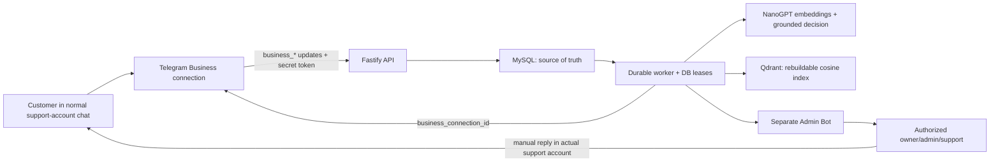

# Telegram AI Support

A production-oriented Telegram customer-support system in which customers keep chatting with a normal Telegram support account. An official Telegram Business Connected Bot receives and answers those chats on behalf of the account; a separate, allowlisted Admin Bot manages knowledge, handoffs, status, and access. There is no customer-facing bot chat and no MTProto user login, phone number, OTP, GramJS session, or stored user session.

## System overview



The code is a modular monolith. `telegram-business` owns Bot API ingestion and guarded sends; `telegram-admin` owns Persian guided menus and notifications; `knowledge` and `indexing` own MySQL-first knowledge changes and durable Qdrant jobs; `retrieval` validates Qdrant candidates against current MySQL state; `ai` enforces structured grounded decisions; `conversations` serializes work per chat; `handoffs` owns atomic mode transitions; `workers` processes durable jobs and expiry; `security` and `observability` provide authorization, secret checking, redaction, health, and correlation IDs.

## Important invariants

- MySQL is authoritative. Qdrant can be deleted and rebuilt.
- Every customer message/update is deduplicated before work is queued. A database lease prevents concurrent AI responses in one conversation.
- A model answer is rejected unless it contains at least one supporting chunk ID from the current retrieval result. Retrieved chunks are checked again against the active, non-deleted, `READY` MySQL version.
- Customer text, conversation context, and retrieved knowledge are all treated as untrusted prompt data. They cannot override system instructions.
- Normal AI sends are allowed only in `AI` mode, with an enabled connection, `can_reply`, and an unexpired Telegram reply window. Telegram’s response remains the final authority.
- Entering `HUMAN` mode and creating the handoff is one MySQL transaction. Re-enabling AI never proactively messages the customer.
- The Admin Bot cannot reply to a customer. Humans reply only from the actual customer chat inside the connected support account.

## Requirements

- macOS or Linux
- A supported Node.js release: Node `20.19+`, `22.13+`, or `24+` (odd-numbered/EOL releases are intentionally excluded)
- MySQL 8.0+
- A Qdrant Cloud cluster or self-hosted Qdrant URL; Docker is not required
- A NanoGPT API key
- Two BotFather bots: one Business Connected Bot and one separate Admin Bot
- A public HTTPS origin for production webhooks

## Local setup on macOS

```bash
brew install node@24 mysql
brew services start mysql
cd /Users/mac/projects/telegram-ai-support
cp .env.example .env
npm ci
```

Edit `.env` before running application commands. `.env` is ignored by Git. Do not copy real tokens into `.env.example`.

### MySQL setup

Create a least-privilege application database/user. The migration user needs DDL privileges; a separately provisioned runtime user can be limited to DML after deployment.

```sql
CREATE DATABASE telegram_ai_support CHARACTER SET utf8mb4 COLLATE utf8mb4_unicode_ci;
CREATE USER 'support_user'@'localhost' IDENTIFIED BY 'replace-with-a-long-random-password';
GRANT ALL PRIVILEGES ON telegram_ai_support.* TO 'support_user'@'localhost';
FLUSH PRIVILEGES;
```

Set `DATABASE_URL`, then run:

```bash
npm run prisma:generate
npm run prisma:migrate
npm run prisma:seed
```

`prisma:seed` creates or updates the owner from `TELEGRAM_OWNER_ID`, adds `TELEGRAM_INITIAL_ADMIN_IDS`, and grants them access to the initial business account. Set `SEED_BUSINESS_ACCOUNT_ID` and `SEED_BUSINESS_ACCOUNT_NAME` if a stable custom ID/name is required.

### Qdrant Cloud setup

1. Create a cluster at Qdrant Cloud and copy its HTTPS endpoint and API key.
2. Set `QDRANT_URL`, `QDRANT_API_KEY`, and `QDRANT_COLLECTION`.
3. Set `OPENAI_EMBEDDING_MODEL`. Either set its correct `OPENAI_EMBEDDING_DIMENSIONS`, or set dimensions to `0` so `qdrant:init` makes one live embedding probe.
4. Run `npm run qdrant:init`.

The collection uses cosine similarity and keyword/bool payload indexes. A self-hosted HTTPS endpoint works with an empty `QDRANT_API_KEY`.

### NanoGPT setup

Create a NanoGPT API key and set `OPENAI_API_KEY`. Keep `OPENAI_BASE_URL=https://nano-gpt.com/api/v1`; the variable retains its OpenAI name because the bot uses the OpenAI-compatible SDK. `OPENAI_CHAT_MODEL` and `OPENAI_EMBEDDING_MODEL` are configuration, not code constants. Choose model IDs supported by NanoGPT. The implementation uses NanoGPT's OpenAI-compatible Responses API with strict JSON-schema output and `store: false`, plus its embeddings endpoint. No live AI-provider call is made by the test suite.

## Create and configure the Telegram bots

### 1. Business Connected Bot

1. In [@BotFather](https://t.me/BotFather), run `/newbot` and create the business bot.
2. Open the bot’s settings and enable the current Business/Secretary Mode option. Telegram’s current feature guide may label this **Secretary Mode**; older clients and requirements often call it **Business Mode**.
3. Put its token in `TELEGRAM_BUSINESS_BOT_TOKEN`.
4. In the normal support account’s Telegram settings, connect that bot as the account’s business bot and select the customer chats/recipients it may manage.
5. Grant only **Reply to messages** (`can_reply`). Do not grant delete, profile, gift, star, story, or other permissions.
6. Grant **Read messages** (`can_read_messages`) only if you deliberately set `TELEGRAM_MARK_READ=true`. The default is false, and the code will not call `readBusinessMessage` without both the configuration flag and the right.

Telegram documents the current `BusinessConnection.rights` object and the rule that reply permission applies to private chats with an incoming message in the preceding 24 hours in the [official Bot API](https://core.telegram.org/bots/api) and [Business Bot rights reference](https://core.telegram.org/constructor/businessBotRights). The system accepts the legacy `can_reply` field only for backward compatibility but persists the current complete rights payload.

### 2. Admin Bot

1. Create a second bot with `/newbot` in BotFather.
2. Put its token in `TELEGRAM_ADMIN_BOT_TOKEN`.
3. Put the owner’s numeric Telegram user ID in `TELEGRAM_OWNER_ID` and optional initial IDs in `TELEGRAM_INITIAL_ADMIN_IDS`.
4. After seeding, the owner can add `ADMIN` and `SUPPORT` users from the Admin Bot. Only the owner can change authorization.

The two tokens, webhook paths, and secret tokens must all be distinct.

## Development

For local long polling (development/test only):

```dotenv
NODE_ENV=development
TELEGRAM_TRANSPORT=polling
RUN_WORKERS_IN_API=true
PUBLIC_BASE_URL=https://unused.example
```

Then:

```bash
npm run dev
```

The process removes existing webhooks without dropping pending updates, starts both polling loops, the HTTP health server, and the durable worker. Production configuration rejects polling. For webhook-style local testing, use an HTTPS tunnel, keep `TELEGRAM_TRANSPORT=webhook`, run `npm run telegram:set-webhooks`, and run `npm run dev`.

## Production webhooks and processes

Set `NODE_ENV=production`, `TELEGRAM_TRANSPORT=webhook`, `RUN_WORKERS_IN_API=false`, and a public HTTPS `PUBLIC_BASE_URL`. Put a reverse proxy/load balancer in front of Fastify, terminate TLS there, and pass only the intended host/forwarding headers. Generate independent random webhook secrets of at least 32 characters.

```bash
npm ci
npm run prisma:migrate
npm run qdrant:init
npm run telegram:set-webhooks
npm run build
npm prune --omit=dev
npm run start       # API/webhooks
npm run worker:start # separate durable worker process
```

Run the API and worker under `launchd`, systemd, or another process supervisor with restart limits, a non-root OS user, a read-only application directory, and secrets supplied by the host secret manager. Multiple API and worker instances are supported; database compare-and-set leases serialize jobs. During a rolling deployment, apply backward-compatible migrations before replacing processes.

Webhook routes:

- Business: `TELEGRAM_BUSINESS_WEBHOOK_PATH`
- Admin: `TELEGRAM_ADMIN_WEBHOOK_PATH`

Both require Telegram’s `X-Telegram-Bot-Api-Secret-Token`. `/health/live` verifies the process. `/health/ready` checks MySQL, Qdrant, required configuration, and expected webhook URLs (or accepted local polling mode).

## Knowledge administration

The Persian Admin Bot supports add, paginated list/view, search, title/description edit, enable/disable, confirmed soft deletion, indexing status, and failed-index retry. Incomplete add/edit/search/admin flows are stored in `AdminFlowState` for one hour, so restarts do not lose them. Every knowledge mutation stores MySQL first and creates the durable indexing job in the same transaction.

Indexing splits descriptions at paragraph/sentence boundaries with overlap, embeds every chunk, performs idempotent deterministic Qdrant upserts, removes obsolete versions, and marks MySQL `READY`. Temporary errors use bounded exponential retry; terminal failures become `FAILED` and notify administrators.

To rebuild the complete Qdrant index from active MySQL knowledge during a maintenance window (pause the normal worker first):

```bash
npm run qdrant:reindex
```

This recreates only the configured Qdrant collection, queues every active current MySQL version, processes the durable jobs, and exits non-zero if any active item fails. It never deletes MySQL knowledge.

## Human handoff and the two 24-hour mechanisms

These mechanisms are independent:

1. **Application human mode:** a handoff moves a conversation to `HUMAN` until `humanModeExpiresAt`, normally 24 hours. AI is silent. The durable worker atomically returns expired conversations to `AI`, marks the handoff `EXPIRED`, audits, and notifies admins. It sends no customer message. **Enable AI Now** resolves immediately; **Keep Human for Another 24 Hours** sets expiry to 24 hours from the button press.
2. **Telegram Business reply window:** the bot may send/edit on behalf of the account only when that private customer chat received an incoming message in the preceding 24 hours. `lastCustomerMessageAt` and `telegramReplyWindowExpiresAt` are tracked, but Telegram’s API response is final. An expiry rejection is recorded and not continuously retried. A new customer message reopens the window. The human account owner may still reply manually according to Telegram client capabilities.

Handoff notifications show customer identity, recent context, reason/timestamps, both remaining windows, and mode buttons. A `https://t.me/<username>` button is used only when a username exists. Otherwise the bot explains that no reliable direct link can be made and gives the numeric identity for locating the chat in the actual support account.

Outgoing `business_message` updates with `sender_business_bot` are stored as `AI`; outgoing messages from the business account without that marker are `HUMAN`. Neither is queued as a customer question. Manual human replies do not trigger an AI answer and do not themselves change human-mode expiry.

## Roles

- `OWNER`: all features, including authorization management.
- `ADMIN`: knowledge, handoffs, modes, status, and audit.
- `SUPPORT`: handoff/status/context operations; access is scoped by business-account assignment.

Access is checked against active MySQL records, not an in-memory list. The seed environment is only the bootstrap path.

## Scripts

| Command                                   | Purpose                                                            |
| ----------------------------------------- | ------------------------------------------------------------------ |
| `npm run dev`                             | Watch-mode API; polling and in-process worker follow configuration |
| `npm run build` / `npm run start`         | Compile strict TypeScript and run production JS                    |
| `npm run worker` / `npm run worker:start` | Development TS worker / compiled production worker                 |
| `npm run typecheck`                       | Strict no-emit TypeScript validation                               |
| `npm run lint`                            | Type-aware ESLint                                                  |
| `npm run format` / `format:check`         | Prettier write/check                                               |
| `npm run test` / `test:coverage`          | Mocked unit tests / V8 coverage                                    |
| `npm run prisma:generate`                 | Generate Prisma client                                             |
| `npm run prisma:migrate`                  | Deploy checked-in MySQL migrations                                 |
| `npm run prisma:seed`                     | Bootstrap business account and admins                              |
| `npm run qdrant:init` / `qdrant:reindex`  | Initialize or fully rebuild the vector index                       |
| `npm run telegram:set-webhooks`           | Configure both HTTPS webhooks and allowed update types             |
| `npm run telegram:delete-webhooks`        | Delete both webhooks without dropping pending updates              |
| `npm run check`                           | Format check, lint, typecheck, tests, and production build         |

## Backup and recovery

- Take encrypted, tested MySQL full backups plus binlog/PITR backups appropriate to your RPO. Back up before migrations and test restores into an isolated database.
- Store application configuration/secrets in a separate secret manager with version history; never put them in database dumps or Git.
- Qdrant snapshots are useful for faster recovery but are not authoritative. After a lost/corrupt index, run `qdrant:reindex` from restored MySQL.
- Telegram does not replay arbitrarily old updates. MySQL message/audit retention and backups are therefore part of the support record.
- To rotate a bot token, revoke it in BotFather, update the secret manager, restart the applicable process, and set that webhook again. Rotate one bot at a time.

## Security notes

- The service never authenticates a user account and never stores phone/OTP/MTProto sessions.
- Structured logs redact tokens, authorization/webhook headers, API keys, and message text unless `LOG_PERSONAL_DATA=true`; leave it false in production.
- Fastify limits bodies, applies security headers, rate-limits webhook routes, validates update shapes, uses correlation IDs, and returns sanitized errors.
- Telegram IDs use MySQL `BIGINT` and TypeScript `bigint`; numeric JSON values must pass a safe-integer check before conversion.
- All database operations are parameterized through Prisma except the constant `SELECT 1` health probe.
- Customer input and knowledge are not trusted as model instructions. Do not put secrets in knowledge descriptions.
- Restrict database/Qdrant/NanoGPT egress and credentials to the API/worker hosts. Limit Admin Bot access by MySQL role and business assignment.
- Review retention, data-processing agreements, regional requirements, and user notice/consent for NanoGPT, Telegram, Qdrant, and backups before production use.

## Troubleshooting

- **`BOT_BUSINESS_MISSING` / business connection not allowed:** enable Business/Secretary Mode for the Business Bot in BotFather, then disconnect/reconnect it in the support account.
- **Connection disabled:** the support account revoked, paused, or changed the connection. The latest `business_connection` update sets `enabled=false`; reconnect in Telegram. AI will remain blocked until an enabled update arrives.
- **Missing `can_reply`:** reconnect or edit the connection and grant only Reply. The Admin Bot connection screen shows the persisted status.
- **`can_read_messages` error:** keep `TELEGRAM_MARK_READ=false`, or explicitly grant Read messages. Reply permission alone is sufficient for normal operation.
- **24-hour rejection:** wait for a new customer message; do not repeatedly retry. The human owner can open the normal account chat and respond manually.
- **Webhook receives nothing:** confirm public HTTPS, exact `PUBLIC_BASE_URL`, reverse-proxy path, firewall, and `npm run telegram:set-webhooks`; inspect `/health/ready` and Bot API webhook info.
- **Webhook `401`:** set a different exact secret for each route and rerun the webhook command after changing it.
- **Qdrant dimension mismatch:** the collection was created for another embedding configuration. Pause workers, verify the model/dimensions, then run `qdrant:reindex`.
- **Knowledge remains `FAILED`:** inspect structured worker logs by knowledge/job ID, repair credentials/network/input, then use Retry Indexing.
- **No direct customer link:** Telegram usernames are optional and `tg://user` behavior is client-dependent. Use the identity in the handoff notification to find the chat in the support account.

## Credentials you must provide

- `DATABASE_URL`
- `TELEGRAM_BUSINESS_BOT_TOKEN`
- `TELEGRAM_ADMIN_BOT_TOKEN`
- two separate webhook secrets
- `TELEGRAM_OWNER_ID` (and optional initial IDs)
- `OPENAI_API_KEY`, `OPENAI_BASE_URL`, chat model, embedding model/dimension
- `QDRANT_URL`, API key if required, and collection name
- production `PUBLIC_BASE_URL`

The test suite requires none of these real credentials; all external NanoGPT, Telegram, and Qdrant behavior is mocked or tested through typed ports.
